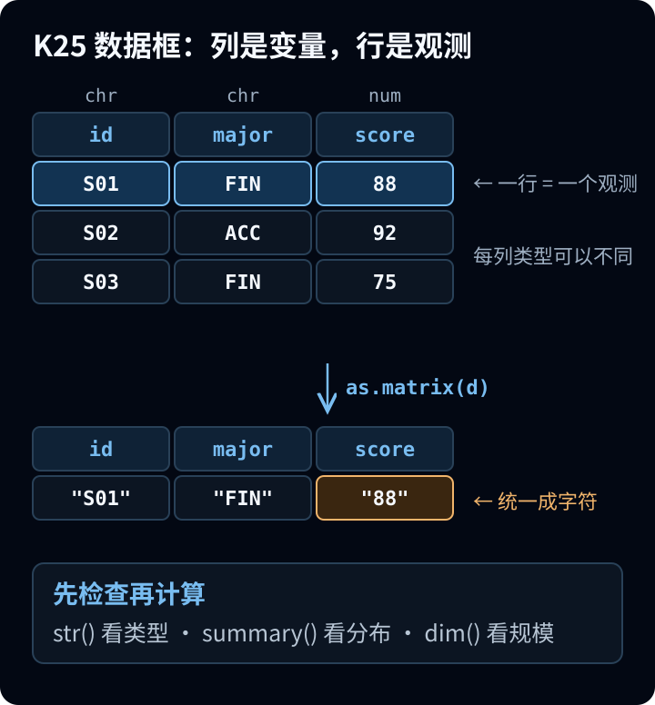

# K25 数据框创建与检查

## 基本信息

- 所属单元为数据框整理。
- 难度为核心。
- 前置知识为K04、K09、K19。
- 关联知识为K26、K27、K28、K30。
- 编写人为Claude（AI辅助编写），样品版本为1.0，日期为2026年11月16日。
- 例题和练习数据均为原创模拟教学数据。
- 验证状态为待R实测。

## 学习目标

- 能够用`data.frame()`创建数据框，说明“每列一个变量、每行一个观测”的组织方式。
- 能够用`str()`、`summary()`、`dim()`、`names()`、`head()`快速检查数据的规模、类型和缺失情况。
- 能够解释数据框转换为矩阵时类型会被统一，避免数值列意外变成字符。

## 先备检查

1. `c(1, "2")`的类型是什么？预期回答为字符型。
2. 矩阵中的元素能否同时有数值和字符？预期回答为不能，矩阵所有元素类型相同。

## 直观理解

数据框就像一张带表头的成绩单：每一列是一个变量，比如学号、专业、分数；每一行是一个人的一条记录。和矩阵不同，数据框的各列可以是不同类型，学号是字符，分数是数值。拿到一张新表，第一件事不是计算，而是检查：有几行几列、每列是什么类型、哪里有缺失。`str()`看结构，`summary()`看分布，`head()`看前几行。

## 为什么

1. 为什么要显式写`stringsAsFactors = FALSE`？R 4.0以后默认就不会把字符转为因子，但旧版本和部分教材会转换，写明参数能让代码在不同版本中表现一致。
2. 为什么数据框转成矩阵后分数变成了文字？矩阵只能有一种类型，只要有一列是字符，所有列都会被转为字符，计算时就会出错。
3. 为什么各列长度必须相同？每一行代表一个观测，某一列少了值就无法对齐，R会直接报错，而不是自动补齐。

## 基础例题

创建包含整数、字符和缺失值的数据框，用`str()`和`summary()`检查，并把频数表转换为数据框。

独立脚本见[K25_example_01.R](../ai_tutor/content_assets/code/K25_example_01.R)。

```r
d <- data.frame(id=1:3,name=c("A","B","C"),score=c(80,NA,90),stringsAsFactors=FALSE)
str(d); print(summary(d)); print(as.data.frame(table(c("a","a","b"))))
```

### 预期输出（待R实测）

```text
'data.frame':	3 obs. of  3 variables:
 $ id   : int  1 2 3
 $ name : chr  "A" "B" "C"
 $ score: num  80 NA 90
       id             name       score     
 Min.   :1.0   Length   :3   Min.   :80.0  
 1st Qu.:1.5   N.unique :3   1st Qu.:82.5  
 Median :2.0   N.blank  :0   Median :85.0  
 Mean   :2.0   Min.nchar:1   Mean   :85.0  
 3rd Qu.:2.5   Max.nchar:1   3rd Qu.:87.5  
 Max.   :3.0                 Max.   :90.0  
                             NAs    :1     
  Var1 Freq
1    a    2
2    b    1
```

### 逐步讲解

1. `str()`第一行给出3个观测、3个变量，之后每行一个变量，依次是类型和前几个值。
2. `id`是整数，`name`是字符，`score`是数值且含有1个缺失值。
3. `summary()`对数值列给出最小值、四分位数、均值和最大值，并单独统计`NAs`。
4. 字符列在R 4.6中显示长度、不同值个数、空串个数和字符长度范围，较早版本的显示方式不同。
5. `as.data.frame(table(...))`把频数表转换为两列：取值`Var1`和频数`Freq`。

## 应用例题

四名学生的学号、专业和成绩组成一张表。需要报告表的规模、列名、前两行，并筛选出金融专业（FIN）的学生。

独立脚本见[K25_example_02.R](../ai_tutor/content_assets/code/K25_example_02.R)。

```r
d <- data.frame(id = c("S01", "S02", "S03", "S04"),
                major = c("FIN", "ACC", "FIN", "ECO"),
                score = c(88, 92, 75, 81),
                stringsAsFactors = FALSE)
print(dim(d))
print(names(d))
print(head(d, 2))
print(d[d$major == "FIN", ])
```

### 预期输出（待R实测）

```text
[1] 4 3
[1] "id"    "major" "score"
   id major score
1 S01   FIN    88
2 S02   ACC    92
   id major score
1 S01   FIN    88
3 S03   FIN    75
```

### 逐步讲解

1. `dim()`给出4行3列，即4名学生、3个变量。
2. `names()`列出变量名，后续取列时要用到它们。
3. `head(d, 2)`只显示前两行，大表格检查时常用。
4. 筛选条件写在行的位置，列的位置留空表示保留所有列。
5. 筛选结果保留了原始行号1和3，可以据此追溯到原表的哪一行。

## 图解方案

图名为“数据框：列是变量，行是观测”，采用表格示意图，以SVG手绘。表头三列分别标注字符、字符、数值类型，用竖向色带表示“同一列类型相同”，用横向高亮表示“一行是一个观测”，下方对比转为矩阵后全部变成字符。



图把数据框和矩阵的关键差异放在一起：数据框允许各列类型不同，矩阵会把类型统一。

## 易错案例

创建数据框时两列长度不同，R直接报错。

```r
d <- data.frame(id = 1:3, score = c(80, 90))
```

### 实际错误或异常结果（待R实测）

```text
Error in data.frame(id = 1:3, score = c(80, 90)) : 
  arguments imply differing number of rows: 3, 2
```

参考修正为缺少的成绩明确写上`NA`，让每一列都有3个值。

```r
d <- data.frame(id = 1:3, score = c(80, 90, NA))
print(d)
```

### 预期输出（待R实测）

```text
  id score
1  1    80
2  2    90
3  3    NA
```

用`NA`补齐的前提是清楚它对应哪个学生。如果原始数据的顺序已经无法核对，应回到数据来源，而不是随意把`NA`放在末尾。

## 完整练习

一张表包含姓名和成绩两列。要求检查成绩列的类型，把数据框转换为矩阵后再检查同一列的类型，打印矩阵，最后用数据框中的原始列计算平均分。

提示`class()`可以查看类型，矩阵按列名取列也用`[, "列名"]`。

独立脚本见[K25_exercise.R](../ai_tutor/content_assets/code/K25_exercise.R)。

```r
d <- data.frame(name = c("Ann", "Ben"), score = c(80, 95), stringsAsFactors = FALSE)
m <- as.matrix(d)
print(class(d$score))
print(class(m[, "score"]))
print(m)
print(mean(d$score))
```

### 预期输出（待R实测）

```text
[1] "numeric"
[1] "character"
     name  score
[1,] "Ann" "80"
[2,] "Ben" "95"
[1] 87.5
```

评分共10分，两次类型检查各得2分，能说明转换后分数带引号的原因得3分，用原数据框正确计算均值得3分。常见错误是对矩阵调用`mean(m[, "score"])`，结果为`NA`并伴随警告，因为字符无法求平均。

## 自测题

1. 预测下面三行的输出。

```r
d <- data.frame(x = 1:3, y = c("a", "b", "c"))
print(dim(d))
print(class(d$y))
print(ncol(as.matrix(d)))
```

### 预期输出（待R实测）

```text
[1] 3 2
[1] "character"
[1] 2
```

R 4.0以后字符列默认保持字符型；转换为矩阵不改变列数，只改变类型。

2. `str(d)`和`summary(d)`哪个更适合检查每列的类型？答案为`str(d)`，它逐列列出类型；`summary(d)`侧重分布和缺失统计。

## 追问建议

- 例题请求用`read.csv()`读入一个文件后做同样的检查，衔接K38。
- 易错点请求解释`stringsAsFactors`在R 4.0前后的差异。
- 练习请求给表增加一列“是否及格”，衔接K26。
- 相关知识继续学习K26，按条件筛选行、选择列和新增列。

## 来源与验证

- 课程来源为[S3《CH2R语言数据操作课件.pdf》PDF 66–69](../../成员一/CH2R语言数据操作课件.pdf#page=66)。
- 课程来源为S4《R数据科学_译本.pdf》第6章。
- 补充来源为R官方帮助主题`help("data.frame")`、`help("str")`、`help("summary")`。
- 本文代码尚未在R中运行，输出为编写者依据R规则推算的预期结果。基础例题与课程资料中R 4.6.1的实测输出一致；数据框打印排版用按R规则编写的辅助程序生成。
- 核对方法为在ai_tutor目录运行`python scripts/check_r_outputs.py K25`，全部通过后加`--write`标记为已实测。
- 图解为SVG手绘，未附生成脚本。
