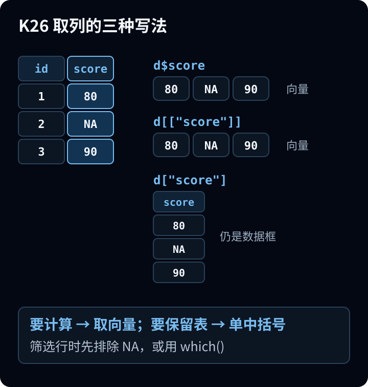

# K26 数据框取列、筛选与增列

## 基本信息

- 所属单元为数据框整理。
- 难度为核心。
- 前置知识为K05、K06、K10、K25。
- 关联知识为K10、K25、K27、K28。
- 编写人为Claude（AI辅助编写），样品版本为1.0，日期为2026年11月16日。
- 例题和练习数据均为原创模拟教学数据。
- 验证状态为待R实测。

## 学习目标

- 能够区分`d$col`、`d[["col"]]`返回向量与`d["col"]`返回数据框。
- 能够用逻辑条件筛选行，并在条件中先排除缺失值，避免出现全为`NA`的行。
- 能够用`d$new <- ...`新增列，确认新列长度与行数一致。

## 先备检查

1. `c(80, NA, 90) > 85`的结果是什么？预期回答为`FALSE NA TRUE`。
2. `which(c(FALSE, NA, TRUE))`返回什么？预期回答为3，`which()`会跳过缺失值。

## 直观理解

从数据框里取东西前，先想清楚要的是“一列数字”还是“一张小表”。`d$score`和`d[["score"]]`把这一列的内容直接拿出来，得到向量，适合计算；`d["score"]`保留表的外壳，得到只有一列的数据框，适合继续当作表来处理。筛选行时写`d[条件, 列]`，条件对每一行回答“要不要”。条件中出现缺失值时，R不知道该保留还是丢弃，就会多出一行全是`NA`的记录。

## 为什么

1. 为什么`d[d$score > 85, ]`会出现一行全是`NA`？比较遇到缺失值得到`NA`，逻辑索引中的`NA`会生成一个缺失行，而不是被跳过。
2. 为什么筛选单列时要写`drop = FALSE`？只选一列时，`d[行, "列"]`默认降为向量，`drop = FALSE`保留数据框结构。
3. 为什么新增列时结果可能出乎意料？给新列赋值时，长度为1的值会重复到每一行；长度不匹配时R会报错，长度能整除时则可能悄悄循环补齐。

## 基础例题

根据成绩新增“是否达标”列，筛选达标学生的编号和成绩，并比较两种取列方式的结果。

独立脚本见[K26_example_01.R](../ai_tutor/content_assets/code/K26_example_01.R)。

```r
d <- data.frame(id=1:3,score=c(80,NA,90))
d$pass <- !is.na(d$score) & d$score>=85
print(d[d$pass,c("id","score"),drop=FALSE])
print(d["score"])
print(class(d$score))
print(class(d["score"]))
```

### 预期输出（待R实测）

```text
  id score
3  3    90
  score
1    80
2    NA
3    90
[1] "numeric"
[1] "data.frame"
```

### 逐步讲解

1. `!is.na(d$score) &`先排除缺失，第2行的结果为`FALSE`而不是`NA`。
2. 新列`pass`逐行保存逻辑值，长度与行数相同。
3. 按`pass`筛选行、按名称选两列，只剩第3行。
4. `d["score"]`仍是数据框，带有行号和列名。
5. `class()`确认`$`得到数值向量，单中括号加列名得到数据框。

## 应用例题

五名学生中S02缺考。需要筛选出成绩不低于80分的学生，给每人加5分作为附加分列，并统计达标人数。

独立脚本见[K26_example_02.R](../ai_tutor/content_assets/code/K26_example_02.R)。

```r
d <- data.frame(id = c("S01", "S02", "S03", "S04", "S05"),
                score = c(92, NA, 78, 85, 60))
ok <- !is.na(d$score) & d$score >= 80
print(d[ok, ])
d$bonus <- d$score + 5
print(d[c("id", "bonus")])
print(sum(ok))
```

### 预期输出（待R实测）

```text
   id score
1 S01    92
4 S04    85
   id bonus
1 S01    97
2 S02    NA
3 S03    83
4 S04    90
5 S05    65
[1] 2
```

### 逐步讲解

1. 条件先排除缺失，再比较分数，结果中没有缺失行。
2. 行号1和4保留了原始位置，便于回查。
3. 新列`bonus`由成绩逐行加5得到，缺考学生仍为`NA`。
4. 用列名向量取两列，结果是数据框。
5. `sum(ok)`统计达标人数为2。

加分列是派生数据，原始成绩列保持不变，以后规则调整时可以重新计算。缺考学生的附加分为`NA`，是否给予补考机会属于课程规则，代码不应自动替换为0。

## 图解方案

图名为“取列的三种写法”，采用对照图，以SVG手绘。左侧是一张3行2列的数据框，右侧三行分别展示`d$score`、`d[["score"]]`得到的竖排数字向量，以及`d["score"]`得到的带表头和行号的小表。



图让学生在取列前先判断需要哪种结果：要计算就取向量，要保留表结构就用单中括号。

## 易错案例

直接用比较条件筛选高分，结果多出一行全是`NA`的记录。

```r
d <- data.frame(id = 1:3, score = c(80, NA, 90))
print(d[d$score > 85, ])
```

### 实际错误或异常结果（待R实测）

```text
   id score
NA NA    NA
3   3    90
```

参考修正用`which()`把条件转换为位置，缺失值会被跳过。

```r
d <- data.frame(id = 1:3, score = c(80, NA, 90))
print(d[which(d$score > 85), ])
```

### 预期输出（待R实测）

```text
  id score
3  3    90
```

多出的那一行行名也是`NA`，很容易被误认为数据里真有这样一位学生。凡是筛选条件涉及可能缺失的列，都应先排除缺失，或者使用`which()`。

## 完整练习

四名学生的数学和英语成绩中各有一个缺失。要求新增总分列，筛选出总分有效且数学不低于80分的学生，只显示姓名和总分；再取出英语成绩向量，并列出所有列名。

提示两科任一缺失时总分为`NA`，筛选条件要先排除它。

独立脚本见[K26_exercise.R](../ai_tutor/content_assets/code/K26_exercise.R)。

```r
d <- data.frame(name = c("Ann", "Ben", "Cai", "Dan"),
                math = c(85, 72, NA, 90),
                eng = c(78, 88, 91, NA))
d$total <- d$math + d$eng
both <- !is.na(d$total) & d$math >= 80
print(d[both, c("name", "total"), drop = FALSE])
print(d[["eng"]])
print(colnames(d))
```

### 预期输出（待R实测）

```text
  name total
1  Ann   163
[1] 78 88 91 NA
[1] "name"  "math"  "eng"   "total"
```

评分共10分，新增总分列得2分，筛选条件正确处理缺失得4分，取向量与列名各得2分。常见错误是条件写成`d$math >= 80`，Dan的数学90分会被选中，但他的总分是`NA`，不满足“总分有效”的要求。

## 自测题

1. 预测下面三行的输出。

```r
d <- data.frame(a = 1:3, b = c(10, 20, 30))
print(class(d$b))
print(class(d["b"]))
print(d[2, "b"])
```

### 预期输出（待R实测）

```text
[1] "numeric"
[1] "data.frame"
[1] 20
```

只取一行一列时，结果降为单个值。

2. `d$new <- 1`能否运行？答案为能，长度为1的值会重复到每一行，新列每行都是1。

## 追问建议

- 例题请求用`subset()`改写筛选，并比较它对缺失值的处理方式。
- 易错点请求解释行名显示为`NA`时意味着什么。
- 练习请求按总分降序排列，衔接K27。
- 相关知识继续学习K28，系统处理数据框中的缺失值和异常值。

## 来源与验证

- 课程来源为[S3《CH2R语言数据操作课件.pdf》PDF 70、72](../../成员一/CH2R语言数据操作课件.pdf#page=70)。
- 补充来源为R官方帮助主题`help("[.data.frame")`、`help("Extract")`、`help("which")`。
- 本文代码尚未在R中运行，输出为编写者依据R规则推算的预期结果。基础例题前两项输出与课程资料中已实测的输出一致；数据框打印排版用按R规则编写的辅助程序生成。
- 核对方法为在ai_tutor目录运行`python scripts/check_r_outputs.py K26`，全部通过后加`--write`标记为已实测。
- 图解为SVG手绘，未附生成脚本。
