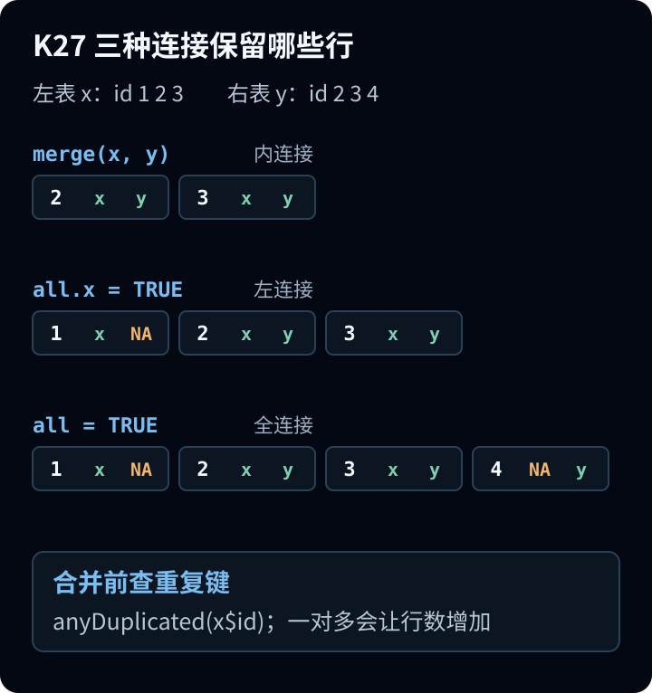

# K27 数据框排序与合并

## 基本信息

- 所属单元为数据框整理。
- 难度为核心。
- 前置知识为K14、K25、K26。
- 关联知识为K12、K14、K20、K29。
- 编写人为Claude（AI辅助编写），样品版本为1.0，日期为2026年11月16日。
- 例题和练习数据均为原创模拟教学数据。
- 验证状态为待R实测。

## 学习目标

- 能够用`d[order(...), ]`对整张表排序，保证同一行的各列始终在一起。
- 能够用`merge()`按键合并两张表，说出内连接、左连接、全连接保留哪些行。
- 能够在合并前检查重复键和未匹配的键，并解释合并后行数变化的原因。

## 先备检查

1. `order(c(30, 10, 20))`的结果是什么？预期回答为`2 3 1`。
2. `setdiff(c("a", "b"), c("b"))`的结果是什么？预期回答为`"a"`。

## 直观理解

排序时要把整行当作一个整体搬动：先用`order()`算出新的行顺序，再按这个顺序取出所有列。如果只把成绩列单独排好放回去，姓名和成绩就对不上了。合并像把两张名单按学号对齐：`merge()`默认只保留两边都有的学号，称为内连接；`all.x = TRUE`保留左表全部学号，右表缺的部分填`NA`。如果右表中同一个学号出现多次，左表的这一行会被复制多份。

## 为什么

1. 为什么合并后行数可能比两张表都多？一个键在两边都重复时会两两配对，比如左表2行、右表3行同为一个学号，结果就有6行。
2. 为什么合并前要先检查重复键？重复往往意味着数据有问题或者本来就是一对多关系，不检查就合并，后续统计会把同一个人算多次。
3. 为什么合并后最好重置行名？`merge()`和排序会让行名变成原表编号的组合，重置后打印更清楚，也避免误把行名当作学号。

## 基础例题

按编号左连接两张表，再按成绩从高到低排列左表。

独立脚本见[K27_example_01.R](../ai_tutor/content_assets/code/K27_example_01.R)。

```r
x <- data.frame(id=1:3,score=c(80,90,70)); y <- data.frame(id=c(2,3),group=c("A","B"))
z <- merge(x,y,by="id",all.x=TRUE)
print(z); print(x[order(x$score,decreasing=TRUE),])
```

### 预期输出（待R实测）

```text
  id score group
1  1    80  <NA>
2  2    90     A
3  3    70     B
  id score
2  2    90
1  1    80
3  3    70
```

### 逐步讲解

1. `by = "id"`指定连接键，`all.x = TRUE`保留左表的全部3个编号。
2. 编号1在右表中没有分组，`group`显示为`<NA>`，尖括号表示字符型缺失值。
3. `order()`给出成绩从高到低的行顺序，所有列一起按这个顺序重排。
4. 行名2、1、3说明了每一行原来的位置。

## 应用例题

学生名单与选课成绩按学号合并。S01选了两门课，S02没有成绩，S04的成绩在名单中找不到人。需要检查重复键、合并、排序，并找出未匹配的学号。

独立脚本见[K27_example_02.R](../ai_tutor/content_assets/code/K27_example_02.R)。

```r
stu <- data.frame(id = c("S01", "S02", "S03"), name = c("Ann", "Ben", "Cai"))
grade <- data.frame(id = c("S01", "S01", "S03", "S04"),
                    course = c("FIN", "ACC", "FIN", "ECO"),
                    score = c(88, 92, 75, 60))
print(anyDuplicated(stu$id))
m <- merge(stu, grade, by = "id")
m <- m[order(m$id, m$course), ]
rownames(m) <- NULL
print(m)
print(setdiff(grade$id, stu$id))
```

### 预期输出（待R实测）

```text
[1] 0
   id name course score
1 S01  Ann    ACC    92
2 S01  Ann    FIN    88
3 S03  Cai    FIN    75
[1] "S04"
```

### 逐步讲解

1. `anyDuplicated()`返回0，说明名单中没有重复学号，每个学号只对应一个学生。
2. 默认的内连接只保留两边都有的学号：S02没有成绩被去掉，S04没有学生信息也被去掉。
3. S01在成绩表中有两条记录，合并后Ann出现两行，这是正常的一对多关系。
4. 按学号和课程排序后重置行名，结果更易阅读。
5. `setdiff()`找出成绩表中多出的学号S04，需要回查是录入错误还是名单遗漏。

合并后有3行，不能说成“3名学生”，实际只有2名学生。统计人数时应使用`length(unique(m$id))`。

## 图解方案

图名为“三种连接保留哪些行”，采用对照图，以SVG手绘。左表学号为1、2、3，右表学号为2、3、4，三行分别展示内连接、左连接和全连接的结果，缺少的值用`NA`格子标出。



图用同一组学号比较三种连接，学生可以直接看出`all.x`、`all.y`和`all`分别多保留了哪些行。

## 易错案例

想把成绩从高到低排序，只对成绩列排序后放回原表，结果姓名和成绩错配。

```r
x <- data.frame(name = c("Ann", "Ben", "Cai"), score = c(80, 95, 70))
x$score <- sort(x$score, decreasing = TRUE)
print(x)
```

### 实际错误或异常结果（待R实测）

```text
  name score
1  Ann    95
2  Ben    80
3  Cai    70
```

参考修正用`order()`对整张表重排行。

```r
x <- data.frame(name = c("Ann", "Ben", "Cai"), score = c(80, 95, 70))
print(x[order(x$score, decreasing = TRUE), ])
```

### 预期输出（待R实测）

```text
  name score
2  Ben    95
1  Ann    80
3  Cai    70
```

错误版本没有任何提示，但Ann的80分变成了95分。排序后检查一两个人的成绩是否与原表一致，就能发现这类问题。

## 完整练习

学生名单有4人，成绩表只有3人的成绩。要求保留全部学生做左连接，统计缺少成绩的人数，再按成绩从高到低排列，缺失成绩的学生排在最后，只显示姓名和成绩。

提示`order()`的`na.last = TRUE`会把缺失值放在最后。

独立脚本见[K27_exercise.R](../ai_tutor/content_assets/code/K27_exercise.R)。

```r
stu <- data.frame(id = c(1, 2, 3, 4), name = c("Ann", "Ben", "Cai", "Dan"))
sc <- data.frame(id = c(2, 4, 1), score = c(88, 95, 70))
joined <- merge(stu, sc, by = "id", all.x = TRUE)
print(nrow(joined))
print(sum(is.na(joined$score)))
ranked <- joined[order(joined$score, decreasing = TRUE, na.last = TRUE), c("name", "score")]
print(ranked)
```

### 预期输出（待R实测）

```text
[1] 4
[1] 1
  name score
4  Dan    95
2  Ben    88
1  Ann    70
3  Cai    NA
```

评分共10分，左连接正确得3分，缺失人数得2分，排序与缺失位置得3分，选择两列得2分。常见错误是使用默认的内连接，Cai被直接去掉，结果看不出有人缺少成绩。

## 自测题

1. 预测两次合并的行数。

```r
a <- data.frame(k = c(1, 2), v = c("x", "y"))
b <- data.frame(k = c(2, 2, 3), w = c(10, 20, 30))
print(nrow(merge(a, b, by = "k")))
print(nrow(merge(a, b, by = "k", all = TRUE)))
```

### 预期输出（待R实测）

```text
[1] 2
[1] 4
```

内连接中键2在右表出现两次，得到2行；全连接再加上只在左表的键1和只在右表的键3，共4行。

2. 合并后行数比左表多，一定是出错了吗？答案为不一定。一对多关系会使行数增加，但需要确认这种重复符合数据的含义。

## 追问建议

- 例题请求用`all.y = TRUE`改写，观察S04的记录。
- 易错点请求说明两张表的键列名称不同时，如何用`by.x`和`by.y`合并。
- 练习请求计算每位学生的平均成绩后再合并，衔接K30。
- 相关知识继续学习K29，了解长表与宽表的转换。

## 来源与验证

- 课程来源为[S3《CH2R语言数据操作课件.pdf》PDF 71、74](../../成员一/CH2R语言数据操作课件.pdf#page=71)。
- 课程来源为[S4《R数据科学_译本.pdf》第9章 PDF 143–159](../../成员一/R数据科学_译本.pdf#page=143)。
- 补充来源为R官方帮助主题`help("merge")`、`help("order")`、`help("anyDuplicated")`。
- 本文代码尚未在R中运行，输出为编写者依据R规则推算的预期结果。基础例题与课程资料中已实测的输出一致；应用例题合并后先排序并重置行名，避免依赖`merge()`内部的行顺序。
- 核对方法为在ai_tutor目录运行`python scripts/check_r_outputs.py K27`，全部通过后加`--write`标记为已实测。
- 图解为SVG手绘，未附生成脚本。
