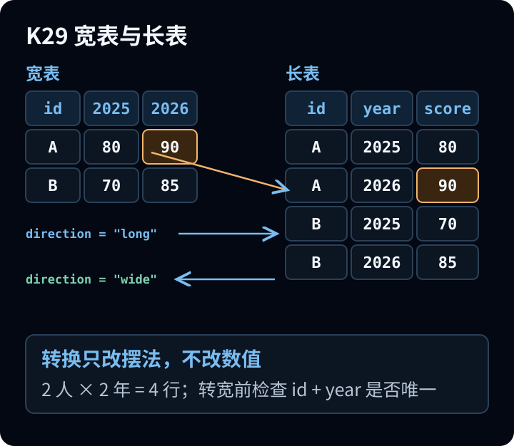

# K29 长宽表转换：基础R

## 基本信息

- 所属单元为数据框整理。
- 难度为扩展。
- 前置知识为K25、K27。
- 关联知识为K27、K30。
- 编写人为Claude（AI辅助编写），样品版本为1.0，日期为2026年11月16日。
- 例题和练习数据均为原创模拟教学数据。
- 验证状态为待R实测。

## 学习目标

- 能够区分宽表（同一变量分散在多列）和长表（变量值集中在一列、另有一列标明时间或类别）。
- 能够用`reshape()`在宽表和长表之间转换，说出`varying`、`v.names`、`timevar`、`times`、`idvar`各自的作用。
- 能够在转换前检查“身份键 + 时间”是否唯一，避免重复记录被悄悄丢弃。

## 先备检查

1. `order(c("B", "A"), c(2, 1))`按什么排序？预期回答为先按第一个向量，再按第二个向量。
2. 数据框中每一行代表什么？预期回答为一个观测。

## 直观理解

同样的成绩可以有两种摆法。宽表是一人一行，2025年和2026年的成绩各占一列，适合人眼对比；长表是一人一年一行，用`year`列写明年份、`score`列存成绩，适合分组汇总和画图。`reshape()`就是在这两种摆法之间切换：转为长表时，要告诉它哪些列是同一个变量（`varying`）、合并后叫什么（`v.names`）、新的时间列叫什么（`timevar`）以及取哪些值（`times`）、靠哪一列识别同一个人（`idvar`）。

## 为什么

1. 为什么转长表后行数会增加？每人每个时间点一行，2人2年就变成4行，信息没有增减，只是换了摆法。
2. 为什么长表的行名是`A.2025`这种形式？`reshape()`用“身份键.时间”作为行名，便于转回宽表时对应；打印前可以重置行名。
3. 为什么转宽表前要检查重复？同一个人同一年如果有两条记录，宽表里只有一个格子可放，`reshape()`只取第一条并给出警告，另一条就丢失了。

## 基础例题

把两个人两年的成绩从宽表转为长表，排序后再转回宽表。

独立脚本见[K29_example_01.R](../ai_tutor/content_assets/code/K29_example_01.R)。

```r
w <- data.frame(id=c("A","B"),y2025=c(80,70),y2026=c(90,85))
l <- reshape(w,varying=c("y2025","y2026"),v.names="score",timevar="year",times=c(2025,2026),idvar="id",direction="long")
print(l[order(l$id,l$year),])
back <- reshape(l,idvar="id",timevar="year",direction="wide")
print(back)
```

### 预期输出（待R实测）

```text
       id year score
A.2025  A 2025    80
A.2026  A 2026    90
B.2025  B 2025    70
B.2026  B 2026    85
       id score.2025 score.2026
A.2025  A         80         90
B.2025  B         70         85
```

### 逐步讲解

1. `varying`列出要合并的两列，`v.names = "score"`给合并后的列命名。
2. `timevar = "year"`和`times`指定新时间列的名称和取值，与`varying`一一对应。
3. 长表有4行，行名是“编号.年份”。
4. 转回宽表时，列名变为`score.2025`和`score.2026`，数值与原表一致。

## 应用例题

三名学生两次测验的成绩是宽表。需要转为长表，按学号和测验排序并重置行名，统计长表行数和第二次测验的平均分。

独立脚本见[K29_example_02.R](../ai_tutor/content_assets/code/K29_example_02.R)。

```r
w <- data.frame(id = c("S01", "S02", "S03"), q1 = c(80, 72, 90), q2 = c(85, 70, 95))
l <- reshape(w, varying = c("q1", "q2"), v.names = "score", timevar = "quiz",
             times = c("q1", "q2"), idvar = "id", direction = "long")
l <- l[order(l$id, l$quiz), ]
rownames(l) <- NULL
print(l)
print(nrow(l))
print(mean(l$score[l$quiz == "q2"]))
```

### 预期输出（待R实测）

```text
   id quiz score
1 S01   q1    80
2 S01   q2    85
3 S02   q1    72
4 S02   q2    70
5 S03   q1    90
6 S03   q2    95
[1] 6
[1] 83.33333
```

### 逐步讲解

1. 时间列也可以是文字，这里`times`用测验名称`q1`和`q2`。
2. 排序后每名学生的两次测验相邻，便于对比。
3. 重置行名后，行号从1开始连续编号。
4. 3名学生×2次测验，长表共6行。
5. 长表中按条件取出第二次测验的成绩，平均分约83.33。

长表便于下一步分组汇总，例如K30中按测验计算平均分。转换只改变数据的摆法，不应改变任何数值，可以抽查一两个人的成绩核对。

## 图解方案

图名为“宽表与长表”，采用双向转换图，以SVG手绘。左侧宽表一人一行，两个年份各占一列；右侧长表一人一年一行；中间两个箭头分别标注`direction = "long"`和`direction = "wide"`，并用颜色连线标出同一个成绩在两种表中的位置。



图让学生看到“同一个数在两种表中各在哪里”，理解转换不改变数据，只改变组织方式。

## 易错案例

长表中A在2025年有两条记录，转为宽表时只保留了第一条，并给出警告。

```r
l <- data.frame(id = c("A", "A", "B"), year = c(2025, 2025, 2025), score = c(80, 85, 70))
w <- reshape(l, idvar = "id", timevar = "year", direction = "wide")
print(w)
```

### 实际错误或异常结果（待R实测）

```text
  id score.2025
1  A         80
3  B         70
Warning message:
In reshapeWide(...) :
  multiple rows match for year=2025: first taken
```

参考修正在转换前先检查“编号+年份”是否唯一，找出重复的位置。

```r
l <- data.frame(id = c("A", "A", "B"), year = c(2025, 2025, 2025), score = c(80, 85, 70))
print(anyDuplicated(l[c("id", "year")]))
```

### 预期输出（待R实测）

```text
[1] 2
```

`anyDuplicated()`返回第一条重复记录的行号2。查明原因后，可能需要删除误录的那一条，也可能需要先按规则汇总，例如取平均或取最高分。这个选择应由数据含义决定，而不是由`reshape()`的“取第一条”决定。

## 完整练习

在基础例题的宽表中加入2027年的成绩，其中B在2027年缺失。要求转为长表，报告行数和缺失个数，并列出2027年两人的成绩。

提示`times`可以写成`2025:2027`，与`varying`中的三列一一对应。

独立脚本见[K29_exercise.R](../ai_tutor/content_assets/code/K29_exercise.R)。

```r
w <- data.frame(id = c("A", "B"), y2025 = c(80, 70), y2026 = c(90, 85), y2027 = c(92, NA))
l <- reshape(w, varying = c("y2025", "y2026", "y2027"), v.names = "score", timevar = "year",
             times = 2025:2027, idvar = "id", direction = "long")
print(nrow(l))
print(sum(is.na(l$score)))
print(l[l$year == 2027, c("id", "score")])
```

### 预期输出（待R实测）

```text
[1] 6
[1] 1
       id score
A.2027  A    92
B.2027  B    NA
```

评分共10分，`varying`与`times`对应正确得4分，行数与缺失统计各得2分，按年份筛选得2分。常见错误是`times`只写了两年，与三列`varying`数量不一致，R会报错。

## 自测题

1. 预测转换后的维度。

```r
w <- data.frame(id = 1:4, a = 1:4, b = 5:8)
l <- reshape(w, varying = c("a", "b"), v.names = "v", timevar = "t",
             times = c("a", "b"), idvar = "id", direction = "long")
print(dim(l))
```

### 预期输出（待R实测）

```text
[1] 8 3
```

4个编号×2个时间点得到8行，列为`id`、`t`、`v`三列。

2. 想画出每个人成绩随年份变化的折线图，更适合用宽表还是长表？答案为长表，年份和成绩各占一列，绘图函数可以直接使用。

## 追问建议

- 例题请求说明`reshape()`结果中的`reshapeLong`属性有什么作用。
- 易错点请求按“取平均”规则处理重复记录后再转宽表。
- 练习请求把长表按年份计算平均分，衔接K30。
- 相关知识可以了解tidyr包的`pivot_longer()`和`pivot_wider()`，它们是更现代的写法。

## 来源与验证

- 课程来源为[S3《CH2R语言数据操作课件.pdf》PDF 75–78](../../成员一/CH2R语言数据操作课件.pdf#page=75)。
- 课程来源为[S4《R数据科学_译本.pdf》第8章 PDF 125–142](../../成员一/R数据科学_译本.pdf#page=125)。
- 补充来源为R官方帮助主题`help("reshape")`、`help("anyDuplicated")`。
- 本文代码尚未在R中运行，输出为编写者依据R规则推算的预期结果。基础例题与课程资料中已实测的输出一致；警告文字的换行方式可能随平台不同，核对脚本只比对文字内容。
- 核对方法为在ai_tutor目录运行`python scripts/check_r_outputs.py K29`，全部通过后加`--write`标记为已实测。
- 图解为SVG手绘，未附生成脚本。
