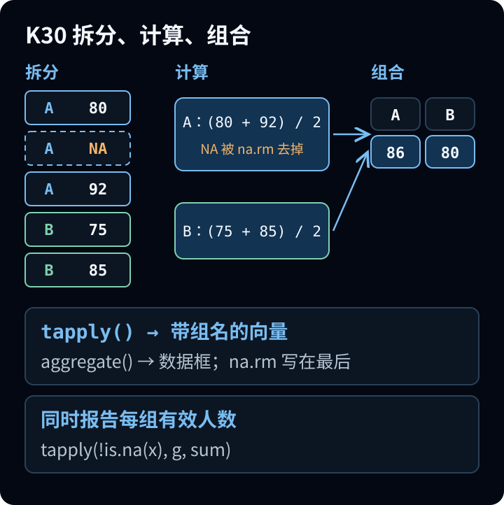

# K30 分组汇总：基础R

## 基本信息

- 所属单元为数据框整理。
- 难度为核心。
- 前置知识为K13、K25、K28。
- 关联知识为K13、K24、K28、K32。
- 编写人为Claude（AI辅助编写），样品版本为1.0，日期为2026年11月16日。
- 例题和练习数据均为原创模拟教学数据。
- 验证状态为待R实测。

## 学习目标

- 能够用`tapply()`和`aggregate()`按类别计算统计量，说明分组变量和被汇总变量的不同角色。
- 能够通过`...`把`na.rm = TRUE`传给汇总函数，并单独统计每组的有效人数。
- 能够把多个分组统计量组合成一张汇总表，用于报告。

## 先备检查

1. `mean(c(80, NA, 92), na.rm = TRUE)`等于多少？预期回答为86。
2. `sum(!is.na(c(80, NA, 92)))`等于多少？预期回答为2，即有效值个数。

## 直观理解

分组汇总分三步：先按类别把数据拆成几组，再对每组分别计算，最后把各组结果拼回一起。`tapply(数值, 分组, 函数)`返回一个带组名的向量，适合快速查看；`aggregate(数值, list(组名 = 分组), 函数)`返回数据框，适合继续合并或导出。两者都把汇总函数后面的额外参数原样传过去，所以`na.rm = TRUE`可以直接写在最后。

## 为什么

1. 为什么某组的平均值是`NA`？组内只要有一个缺失值，`mean()`默认就返回`NA`，需要通过`na.rm = TRUE`去掉缺失。
2. 为什么还要单独报告每组的有效人数？两组均值相同，有效人数可能相差很大，人数越少结论越不稳定。
3. 为什么`aggregate()`的结果列名叫`x`？向量接口没有提供变量名，R默认命名为`x`，需要时可以用`names()`修改。

## 基础例题

按组计算平均分，比较`aggregate()`和`tapply()`的输出形式。

独立脚本见[K30_example_01.R](../ai_tutor/content_assets/code/K30_example_01.R)。

```r
d <- data.frame(group=c("A","A","B"),score=c(80,100,60))
print(aggregate(d$score,list(group=d$group),mean))
print(tapply(d$score,d$group,mean))
```

### 预期输出（待R实测）

```text
  group  x
1     A 90
2     B 60
 A  B 
90 60 
```

### 逐步讲解

1. `aggregate()`的分组参数要放在`list()`中，`group = `成为结果的列名。
2. A组(80 + 100) / 2 = 90，B组只有一人，平均分为60。
3. `aggregate()`返回数据框，`tapply()`返回带组名的向量，数值相同。

## 应用例题

两个班级的成绩中有一个缺失。需要计算每班的平均分（去掉缺失）、每班的有效人数和最高分。

独立脚本见[K30_example_02.R](../ai_tutor/content_assets/code/K30_example_02.R)。

```r
d <- data.frame(class = c("A", "A", "A", "B", "B"), score = c(80, NA, 92, 75, 85))
print(tapply(d$score, d$class, mean, na.rm = TRUE))
print(tapply(!is.na(d$score), d$class, sum))
print(aggregate(d$score, list(class = d$class), max, na.rm = TRUE))
```

### 预期输出（待R实测）

```text
 A  B 
86 80 
A B 
2 2 
  class  x
1     A 92
2     B 85
```

### 逐步讲解

1. `na.rm = TRUE`写在最后，传给每组的`mean()`。A班为(80 + 92) / 2 = 86。
2. `!is.na(d$score)`标出有效成绩，按班求和得到每班的有效人数，两班都是2人。
3. `aggregate()`同样可以传入`na.rm = TRUE`，得到每班的最高分。

A班名单有3人，但有效成绩只有2个。报告时应写“A班有效成绩2个，平均分86”，而不是“A班3人平均86分”。

## 图解方案

图名为“拆分、计算、组合”，采用流程图，以SVG手绘。左侧是混合在一起的五条成绩记录，中间按班级拆成A、B两组，每组旁边写出各自的计算过程，右侧把两个结果组合成一张汇总表，缺失值用虚线框标出并注明被`na.rm`去掉。



图把分组汇总的三个步骤画成一条流水线，强调缺失值在“计算”这一步被处理，处理规则需要写进报告。

## 易错案例

按班计算平均分时没有处理缺失值，A班的结果变成了`NA`。

```r
d <- data.frame(class = c("A", "A", "B"), score = c(80, NA, 70))
print(tapply(d$score, d$class, mean))
```

### 实际错误或异常结果（待R实测）

```text
 A  B 
NA 70 
```

参考修正传入`na.rm = TRUE`，同时统计每组缺失了几个。

```r
d <- data.frame(class = c("A", "A", "B"), score = c(80, NA, 70))
print(tapply(d$score, d$class, mean, na.rm = TRUE))
print(tapply(is.na(d$score), d$class, sum))
```

### 预期输出（待R实测）

```text
 A  B 
80 70 
A B 
1 0 
```

A班的80分只来自1个有效成绩。如果某组全部缺失，`na.rm = TRUE`后的平均值会是`NaN`，提醒这一组没有可用数据。

## 完整练习

五名学生分属金融（FIN）和会计（ACC）两个专业，其中一名会计学生缺少成绩。要求按专业计算有效人数、平均分（保留一位小数）和最高分，并组合成一张三行的汇总表。

提示三个`tapply()`的结果都按专业名排列，可以用`rbind()`按行拼接，并为每行命名。

独立脚本见[K30_exercise.R](../ai_tutor/content_assets/code/K30_exercise.R)。

```r
d <- data.frame(major = c("FIN", "ACC", "FIN", "ACC", "FIN"),
                score = c(88, 76, 92, NA, 81))
n <- tapply(!is.na(d$score), d$major, sum)
avg <- round(tapply(d$score, d$major, mean, na.rm = TRUE), 1)
top <- tapply(d$score, d$major, max, na.rm = TRUE)
print(rbind(n = n, mean = avg, max = top))
```

### 预期输出（待R实测）

```text
     ACC FIN
n      1   3
mean  76  87
max   76  92
```

评分共10分，有效人数得3分，平均分与缺失处理得3分，最高分得2分，汇总表组合与命名得2分。常见错误是用`table(d$major)`当作人数，会计专业会显示2人，但其中1人没有成绩。

## 自测题

1. 预测下面两行的输出。

```r
g <- c("x", "y", "x", "y")
v <- c(1, 2, 3, 4)
print(tapply(v, g, sum))
print(length(tapply(v, g, sum)))
```

### 预期输出（待R实测）

```text
x y 
4 6 
[1] 2
```

x组为1 + 3 = 4，y组为2 + 4 = 6；有两个组，结果长度为2。

2. 想按“专业”和“年级”两个变量交叉分组，`tapply()`的分组参数怎么写？答案为`list(d$major, d$grade)`，结果是一个以两个分组变量为维度的矩阵。

## 追问建议

- 例题请求用公式接口`aggregate(score ~ class, data = d, FUN = mean)`改写，并说明它对缺失值的处理。
- 易错点请求解释`NaN`和`NA`在分组结果中分别意味着什么。
- 练习请求增加一列中位数，并比较与平均分的差异。
- 相关知识继续学习K32，用`sapply()`对多列同时汇总。

## 来源与验证

- 课程来源为[S3《CH2R语言数据操作课件.pdf》PDF 79–82](../../成员一/CH2R语言数据操作课件.pdf#page=79)。
- 课程来源为S4《R数据科学_译本.pdf》第3章。
- 补充来源为R官方帮助主题`help("tapply")`、`help("aggregate")`。
- 本文代码尚未在R中运行，输出为编写者依据R规则推算的预期结果。基础例题与课程资料中已实测的输出一致；汇总表排版用按R规则编写的辅助程序生成。
- 核对方法为在ai_tutor目录运行`python scripts/check_r_outputs.py K30`，全部通过后加`--write`标记为已实测。
- 图解为SVG手绘，未附生成脚本。
